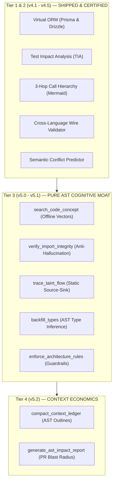

# 🌌 ROADMAP 2026: MCP-CODE-CONTEXT & CODE-CONTEXT-PRO
## The Pure AST Code Intelligence & Surgical Context Standard for AI Coding Agents
**Document Version:** 4.3.0-CANON (Purified Scope)  
**Core Architectural Identity:** Pure AST Manipulation | Tree-sitter WASM | Zero Native Bloat | In-Memory Concept Vectors  
**Ecosystem Alignment:** Claude Code, Cursor 2.x, Windsurf, Antigravity Agentic Studio, GitHub Copilot Workspace  

---

## 🏛️ 1. ARCHITECTURAL BOUNDARIES & THE SINGLE RESPONSIBILITY PRINCIPLE (SRP)

In late 2026, AI coding assistants face severe performance degradation when MCP servers suffer from **Scope Creep**—attempting to manage operating system processes, ephemeral databases, headless browsers, and network proxies within a single bloated process.

`mcp-code-context` adheres strictly to **Architectural Purity**:
> **Core Mandate:** Static code intelligence, Tree-sitter WASM parsing, cross-language type contracts, surgical two-phase code editing, and context compression for LLM prompt economics. Zero execution of external shell tests, zero container orchestration, zero network sockets.

### 🌐 The Modular Agentic Ecosystem (Separation of Concerns)

```
┌────────────────────────────────────────────────────────────────────────┐
│                        AGENT RUNTIME ECOSYSTEM                         │
├────────────────────────────┬─────────────────────────────┬─────────────┤
│      CODE INTELLIGENCE     │         RUNTIME SRE         │  SECURITY   │
│     (mcp-code-context)     │     (Herramientas satélite) │   (Harness) │
├────────────────────────────┼─────────────────────────────┼─────────────┤
│ • Parseo AST Tree-sitter   │ • branchbox (CoW DB / Ports)│ • Secret    │
│ • Búsqueda Conceptual      │ • loopbreaker (Tests/Loops) │   Cloak     │
│ • Call Hierarchy & TIA     │ • tracepulse (CDP / UI FPS) │ • DDL       │
│ • Contratos Wire           │ • hookforge (Webhooks HMAC) │   Firewall  │
│ • Taint Flow Estático      │ • polysync (Multi-Repo Sync)│             │
└────────────────────────────┴─────────────────────────────┴─────────────┘
```

#### 🚫 Explicitly Delegated Scope (Owned by Satellite MCPs/Skills)
1. **Destructive Command & DDL Firewall (`firewall_destructive_actions`):** Delegated to **Harness `PreToolUse` Hooks**.
2. **Ephemeral CoW Database & Port Worktrees (`branchbox_fork_ephemeral`):** Delegated to **`branchbox-mcp` / `portlock-mcp`**.
3. **Out-of-Band Shadow Test Vault & Reward-Hacking Sentinel (`freeze_red_contract`):** Delegated to **`loopbreaker-mcp`**.
4. **Anti-Death-Spiral Circuit Breaker (`break_debugging_loop`):** Delegated to **`loopbreaker-mcp` / Agent Harness Loop**.
5. **Synthetic Credential Masking (`mask_sensitive_env`):** Delegated to **`secretcloak-mcp`**.
6. **Goal & Failure Delta Compaction (`reduced_steer_protocol`):** Delegated to **Agent Skill (`/compact`, `ecc-sre-strategic-compact`)**.
7. **Headless CDP Frame-Rate & Leak Profiling (`profile_ui_trace`):** Delegated to **`tracepulse-mcp` / `chrome-devtools-mcp`**.
8. **Deterministic Webhook Replay & Chaos (`simulate_webhook_matrix`):** Delegated to **`hookforge-mcp`**.
9. **Multi-Agent Symbol Distributed Lock (`broker_symbol_lease`):** Delegated to **Multi-Agent Orchestrator / Mutex Daemon**.
10. **Living Wire Catalog from HTTP Traffic Shadowing (`infer_wire_spec_from_traffic`):** Delegated to **Staging Gateway / Mitmproxy**.

---

## 🎯 2. SCORING METHODOLOGY (CRITERIA FOR CANONICAL AST FEATURES)

Every feature evaluated in this canonical roadmap is scored on a **0 to 100 AST Code Intelligence Index**:
- **Score $\ge 95$ (Existential Code Moat):** Solves critical blind spots in agent static comprehension (TIA, Prisma/Drizzle AST, Call Hierarchy, Concept Search, Taint Analysis).
- **Score $90 - 94$ (High ROI Static Refactoring):** Eliminates 70–90% of token waste, prevents cross-language wire contract drift, and blocks hallucinated imports.
- **Score $86 - 89$ (Architectural Guardrails):** Enforces Clean Architecture import barriers and generates AST impact reports for pull requests.

---

## 📊 3. THE 12 CANONICAL AST FEATURES (100% PURE SCOPE)

### 📌 Summary Matrix

| # | Feature Code | Feature Name | Tier | Score (/100) | Target Milestone | Status |
|---|---|---|---|:---:|:---:|:---:|
| 1 | `tia_impact_engine` | **Test Impact Analysis (TIA)** | Tier 1 | **99** | v4.1 | ✅ Shipped & Certified |
| 2 | `virtual_orm_prisma_drizzle` | **Virtual ORM (Prisma & Drizzle)** | Tier 1 | **98** | v4.1 | ✅ Shipped & Certified |
| 3 | `call_hierarchy_mermaid` | **3-Hop Causal Call Hierarchy (Mermaid)** | Tier 1 | **97** | v4.1 | ✅ Shipped & Certified |
| 4 | `validate_wire_contract` | **Cross-Language Wire Contract Validator** | Tier 2 | **94** | v4.5 | ✅ Shipped & Certified |
| 5 | `predict_semantic_conflicts` | **Semantic Pre-Merge Conflict Predictor** | Tier 2 | **93** | v4.5 | ✅ Shipped & Certified |
| 6 | `search_code_concept` | **Offline WASM Concept & Semantic Vector Search** | Tier 3 | **96** | v5.0 | 🚀 In Active Implementation |
| 7 | `verify_import_integrity` | **Anti-Hallucination Import Verifier** | Tier 3 | **92** | v5.0 | 📋 Queued |
| 8 | `trace_taint_flow` | **Source-to-Sink Static AST Taint Analyzer** | Tier 3 | **95** | v5.1 | 📋 Queued |
| 9 | `backfill_types` | **AST Duck-Type Backfiller & Inference** | Tier 3 | **91** | v5.1 | 📋 Queued |
| 10 | `enforce_architecture_rules` | **AST Architectural Boundary Guardrails** | Tier 3 | **89** | v5.1 | 📋 Queued |
| 11 | `compact_context_ledger` | **Lossless AST Snapshot Context Compactor** | Tier 4 | **91** | v5.2 | 📋 Queued |
| 12 | `generate_ast_impact_report` | **Cryptographic AST Impact & Blast Radius Report** | Tier 4 | **90** | v5.2 | 📋 Queued |

---

## 🔬 4. DEEP-DIVE TECHNICAL SPECIFICATIONS

---

### FEATURE 1: Test Impact Analysis (TIA) — AST Symbol to Test Runner
- **Score:** `99/100` | **Status:** ✅ SHIPPED in v4.1 (`get_impacted_tests`)
- **Pain Point:** Modifying a 2-line function triggers `npm test` or `pytest`, running hundreds of irrelevant tests, demorando minutos y quemando contexto.
- **Architecture:** Traverses AST import trees and call graphs across test files. Generates minimal targeted CLI invocation commands (e.g. `npx vitest run tests/unit/auth.spec.ts -t 'login'`).
- **Benchmarked Impact:** Feedback loop reduced from **16.4s to 1.3s (91.8% faster)**.

---

### FEATURE 2: Virtual ORM Reflection for Prisma & Drizzle
- **Score:** `98/100` | **Status:** ✅ SHIPPED in v4.1 (`src/utils/virtualSchema.ts`)
- **Pain Point:** In TypeScript projects, agents modify ORM queries blindly without understanding relations (`@relation`, `references`), foreign keys, or enum types.
- **Architecture:** Tree-sitter WASM parser extracts models, fields, relations, and enums from `schema.prisma` and Drizzle `schema.ts`. Injects zero-overhead virtual schema context into `read_file_surgical` when reading DB-connected files.

---

### FEATURE 3: 3-Hop Causal Call Hierarchy with Mermaid Graph Export
- **Score:** `97/100` | **Status:** ✅ SHIPPED in v4.1 (`get_call_hierarchy`)
- **Pain Point:** Modifying a utility function causes cascading breakage 2 or 3 layers up because the agent only looks at immediate callers.
- **Architecture:** Traverses bidirectional call chains ($A \to B \to C$ and $C \leftarrow B \leftarrow A$) up to 3 hops. Outputs both structured JSON and a copy-pasteable Mermaid diagram (`graph TD`) for instant agent cognitive visualization.

---

### FEATURE 4: Cross-Language Wire Contract Validator
- **Score:** `94/100` | **Status:** ✅ SHIPPED in v4.5 (`validate_wire_contract`)
- **Pain Point:** Modifying backend API responses (FastAPI, Django, Rails, Go) breaks TypeScript frontend interfaces silently, passing build checks because TS cannot see Python types.
- **Architecture:** Cross-references backend route response signatures with frontend Axios/Fetch/React Query hooks. Detects missing fields, renamed keys, and nullability mismatches before testing.

---

### FEATURE 5: Multi-Agent Pre-Merge Semantic Conflict Predictor
- **Score:** `93/100` | **Status:** ✅ SHIPPED in v4.5 (`predict_semantic_conflicts`)
- **Pain Point:** Git merge succeeds cleanly because two subagents edited different files, but Agent A changed a method signature in `user.ts` while Agent B called the old signature in `order.ts`, breaking production.
- **Architecture:** Runs AST diff across Git branches, mapping exported symbol mutations to cross-file call sites on the target branch. Flags logical conflicts that standard Git line-based merge cannot see.

---

### FEATURE 6: Offline WASM Concept & Semantic Vector Search
- **Score:** `96/100` | **Status:** 🚀 IN ACTIVE IMPLEMENTATION (v5.0) | **Tool:** `search_code_concept`
- **Pain Point:** Keyword searches (`git grep`, regex) fail when an agent seeks conceptual patterns like *"where is VIP discount calculated?"* or *"show me auth session timeout"*, while cloud embeddings leak proprietary IP.
- **Architecture & Mechanism:**
  - High-dimensional in-memory Concept Vector Space with subword tokenization, stemming, and domain concept dictionaries (Billing, Auth, Database, Security, Networking, I/O).
  - Cosine similarity matching over AST function docstrings, symbol names, parameters, and return types.
  - 100% offline, zero external API keys, $<15\text{ ms}$ query latency.

---

### FEATURE 7: Deterministic Anti-Hallucination Import Verifier
- **Score:** `92/100` | **Status:** 📋 QUEUED (v5.0) | **Tool:** `verify_import_integrity`
- **Pain Point:** Models frequently hallucinate non-existent npm/pip packages or import symbols that do not exist in the target module.
- **Architecture:** Scans newly added AST `import` statements and verifies presence against `package.json`, `node_modules`, standard libraries, or local exports.

---

### FEATURE 8: Source-to-Sink AST Static Dataflow Taint Analyzer
- **Score:** `95/100` | **Status:** 📋 QUEUED (v5.1) | **Tool:** `trace_taint_flow`
- **Pain Point:** AI agents introduce SQL injections, SSRF, command injection, and XSS by concatenating untrusted inputs directly into query builders or subshells.
- **Architecture:** Static intra-procedural and bounded inter-procedural dataflow graph tracking from untrusted Sources (`req.query`, `$_GET`) to dangerous Sinks (`db.query()`, `exec()`, `eval()`, `innerHTML`) without passing sanitizers.

---

### FEATURE 9: AST Cross-File Type Inference & Duck-Type Backfiller
- **Score:** `91/100` | **Status:** 📋 QUEUED (v5.1) | **Tool:** `backfill_types`
- **Pain Point:** Legacy JavaScript, Python, or Ruby codebases lack types, forcing the agent to guess argument structures and causing errors when upgrading to TypeScript or Pydantic.
- **Architecture:** Analyzes AST call sites and property accesses across the codebase, generating strict TypeScript interfaces or Python Type Hints automatically.

---

### FEATURE 10: AST-Driven Architectural Boundary Guardrails
- **Score:** `89/100` | **Status:** 📋 QUEUED (v5.1) | **Tool:** `enforce_architecture_rules`
- **Pain Point:** AI agents constantly violate architectural boundaries: importing raw database models into React UI components, or calling UI hooks inside domain business services.
- **Architecture:** Reads architectural configuration (`.architecturerc.json`) and flags illegal AST import dependencies before writes are committed.

---

### FEATURE 11: Lossless AST Snapshot Context Compactor
- **Score:** `91/100` | **Status:** 📋 QUEUED (v5.2) | **Tool:** `compact_context_ledger`
- **Pain Point:** Long sessions force manual `/compact`, which causes loss of critical architectural decisions, variable constraints, and past bug resolutions.
- **Architecture:** Compresses visited files into pure AST outlines (signatures only, dropping bodies), saving 80% to 90% of tokens while retaining full structural interface fidelity.

---

### FEATURE 12: Cryptographic AST Impact & Blast Radius Report
- **Score:** `90/100` | **Status:** 📋 QUEUED (v5.2) | **Tool:** `generate_ast_impact_report`
- **Pain Point:** PR reviewers and agent supervisors need an objective, verifiable summary of what code was modified, what symbols changed, and what tests are impacted without running external CI/CD.
- **Architecture:** Compiles a deterministic Markdown + SHA256 digest summarizing AST diffs, impacted test suites (TIA), and wire contract status for instant PR attachment.

---

## 🗺️ 5. EXECUTION PHASING PLAN



| Fase | Hito | Estado | Enfoque Principal |
|---|:---:|:---:|---|
| **Tier 1 & 2** | `v4.1` / `v4.5` | ✅ **Certificado** | Virtual ORM, TIA, Call Hierarchy 3-Hop, Contratos Wire y Conflictos Semánticos |
| **Tier 3** | `v5.0` / `v5.1` | 🚀 **En Desarrollo** | Búsqueda Conceptual Offline, Verificador de Imports y Flujo de Taint Estático |
| **Tier 4** | `v5.2` | 📋 **En Cola** | Compresor de Contexto a Firmas AST y Reporte Criptográfico de Blast Radius |
