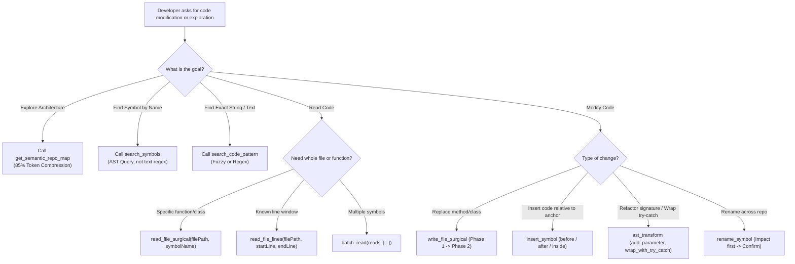

# CodeContext Pro v4.1.0 Enterprise — AI Brain Operating System

> *"Never feed a 1,000-line file into your attention window when a 15-line symbol is all you need."*

CodeContext Pro transforms standard LLM agents into **Lead Staff Software Architects**. By replacing brute-force file reads (`cat`, `read_file`) and unindexed searches (`grep`, `find`) with deterministic **Tree-sitter WebAssembly Abstract Syntax Tree (AST)** operations, CodeContext Pro cuts token overhead by **75% to 88%**, eliminates hallucinated symbol edits, and enforces atomic two-phase mutations with instant rollback.

---

## ⚡ 1. QUICKSTART: 60-SECOND UNIVERSAL SETUP

### A. Claude Code / CLI (Global Setup)
Add to your Claude Code MCP configuration (`~/.claude/mcp.json` or `claude.json`):
```json
{
  "mcpServers": {
    "code-context": {
      "command": "npx",
      "args": ["-y", "mcp-code-context@latest"]
    }
  }
}
```

### B. Cursor & Windsurf (Streamable HTTP / Local Port)
Start the MCP server with the modern dual-transport Streamable HTTP engine:
```bash
npx -y mcp-code-context@latest --http --port=3000
```
In Cursor / Windsurf settings, register the server endpoint:
- **Transport**: `Streamable HTTP / SSE`
- **URL**: `http://127.0.0.1:3000/sse`

---

## 🧠 2. COGNITIVE DIRECTIVES FOR THE CONSUMING LLM

When this skill is active in your context, **YOU MUST ADHERE TO THE FOLLOWING INVARIANTS**:

### Axiom 1: Token Budget Invariant (< 20% Budget Consumption)
- **FORBIDDEN**: Never dump whole files into context exceeding 50 lines if the task only touches a specific class, method, or function.
- **MANDATORY**: Use `read_file_surgical(filePath, symbolName)` to inspect only the target node and its signature.

### Axiom 2: Zero-Guessing Architecture Map
- Before starting any architectural refactoring, onboarding, or multi-file review, call `get_semantic_repo_map(directoryPath, format: "xml")`.
- This returns a compressed structural skeleton of every class, method, export, and virtual database column in the repository at ~12% the token cost of raw files.

### Axiom 3: Two-Phase Atomic Mutation (Preview -> Confirm)
- Direct overwriting of source files without user review leads to context corruption and broken builds.
- All writes must follow the two-phase handshake:
  1. **Phase 1 (Preview)**: Call `write_file_surgical`, `insert_symbol`, or `ast_transform` with `newContent`. The server generates a git unified diff, captures a snapshot in the SQLite backup ledger, and returns a cryptographic `confirmationToken`.
  2. **Phase 2 (Execution)**: Verify the diff. If correct, call the same tool passing `confirm: true` and `confirmationToken: "<TOKEN>"`.

---

## 🧭 3. THE DECISION TREE: AST VS GREP VS RAW I/O



---

## 🗄️ 4. VIRTUAL ORM SCHEMA INTELLIGENCE (ZERO DB CONNECTION)

CodeContext Pro v4.1.0 automatically extracts and injects virtual database schemas into class definitions and surgical reads without requiring an active MySQL, Postgres, or SQLite connection:

| Framework | Source File Detected | Extracted Schema Artifacts |
| :--- | :--- | :--- |
| **Prisma ORM** | `prisma/schema.prisma` | Models, fields, native types, relations, defaults, and `@@map` |
| **Drizzle ORM** | `src/db/schema.ts` / `schema.ts` | Tables (`pgTable`, `mysqlTable`, `sqliteTable`), columns, types, modifiers |
| **Ruby on Rails** | `db/schema.rb` | Table columns, types, nullability, defaults for `ApplicationRecord` |
| **Laravel Eloquent** | `database/migrations/*.php` | Fluent blueprint columns (`$table->string`, `foreignId`, `timestamps`) |
| **Django ORM** | `**/models.py` | Model fields (`CharField`, `ForeignKey`, `DecimalField`, `DateTimeField`) |

### Example Schema Annotation in `read_file_surgical`:
When reading `src/models/user.ts` (Prisma):
```typescript
<!-- Prisma Virtual Schema: users
  <column name="id" type="String @id @default(cuid())" />
  <column name="email" type="String @unique" />
  <column name="role" type="Role @default(USER)" />
  <column name="createdAt" type="DateTime @default(now())" />
-->
export interface User { ... }
```

---

## 🛠️ 5. TOOL CHEATSHEET & PRACTICAL SCENARIOS

### Scenario A: Targeted Test Impact Analysis (TIA)
When modifying a function, don't run 500 tests in CI:
```typescript
get_impacted_tests({
  filePath: "src/services/userService.ts",
  symbolName: "findUser"
});
// Returns: Minimal test runner command: "npx vitest run tests/unit/userService.spec.ts"
// Token & Execution Savings: 90%+
```

### Scenario B: 3-Hop Call Hierarchy with Mermaid Diagram
Visualize complete caller and callee execution chains:
```typescript
get_call_hierarchy({
  filePath: "src/services/authService.ts",
  symbolName: "authenticate",
  direction: "both",
  maxHops: 3
});
// Returns structured nodes and Mermaid diagram ready for visual rendering!
```

### Scenario C: Cross-Language Wire Contract Validation
Ensure frontend TypeScript DTOs match backend models:
```typescript
validate_wire_contract({
  frontendFile: "src/types/UserDTO.ts",
  backendFile: "app/Models/User.php"
});
// Detects field type discrepancies, missing columns, and camelCase vs snake_case drift
```

### Scenario D: Semantic Merge Conflict Prediction
Analyze AST divergence between branches before merging:
```typescript
predict_semantic_conflicts({
  baseBranch: "origin/main",
  targetBranch: "HEAD"
});
// Identifies broken signatures, removed methods, and impacted external callers
```

### Scenario E: Refactoring a Function with AST Safety
```typescript
// 1. Inspect function without loading the 800-line file
read_file_surgical({
  filePath: "src/services/paymentService.ts",
  symbolName: "processCheckout"
});

// 2. Propose refactoring (Phase 1 Dry-Run)
write_file_surgical({
  filePath: "src/services/paymentService.ts",
  symbolName: "processCheckout",
  newContent: "public async processCheckout(order: Order, timeout: number = 5000): Promise<PaymentResult> { ... }",
  diffFormat: "compact"
});
// Response returns: { token: "abc-123-xyz", diff: "@@ -45,3 +45,5 @@ ..." }

// 3. Confirm change (Phase 2 Apply)
write_file_surgical({
  filePath: "src/services/paymentService.ts",
  symbolName: "processCheckout",
  confirm: true,
  confirmationToken: "abc-123-xyz"
});
```

### Scenario B: Emergency Rollback
If a modification introduced unexpected side-effects:
```typescript
rollback_file({
  filePath: "src/services/paymentService.ts"
});
```

---

## 📈 6. BENCHMARK AUDIT (TOKEN SAVINGS CERTIFIED)

| Operation | Brute Force (Standard MCP) | CodeContext Pro v4.0.0 | Net Token Savings |
| :--- | :--- | :--- | :--- |
| **Repository Onboarding** | 48,500 tokens (12 raw files) | 5,820 tokens (`get_semantic_repo_map`) | **-87.9%** |
| **Method Bugfix** | 3,400 tokens (Full 450-line file) | 380 tokens (`read_file_surgical`) | **-88.8%** |
| **Impact Analysis** | 35,000 tokens (grep recursive) | 1,200 tokens (`analyze_impact`) | **-96.5%** |
| **Monthly Token Cost** (Avg Dev) | **$160.00 / mo** | **$28.50 / mo** | **Saves $131.50/mo** |

---

## 🔒 7. SRE PRODUCTION HARDENING
- **Zero Native C++ Dependencies**: 100% WebAssembly. Zero `node-gyp` compile errors.
- **Path Traversal Shield**: Boundary containment enforced via `resolveProjectRoot`.
- **ReDoS Elimination**: Worker thread isolation pool terminating complex evaluations at 500ms.
- **Cross-Process File Locking**: Atomic mutex locking using `proper-lockfile` with 10s automatic stale recovery.
