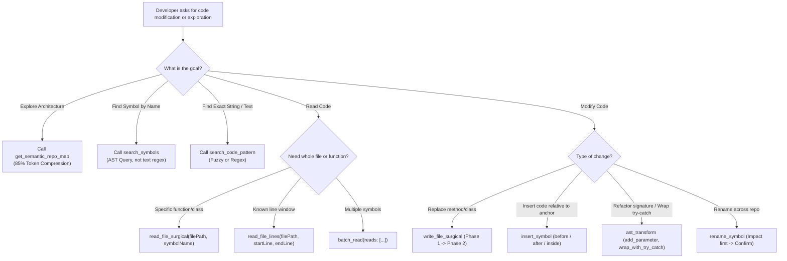

# CodeContext Pro v7.0.1 Enterprise Polyglot — AI Brain Operating System

> *"Never feed a 1,000-line file into your attention window when a 15-line symbol is all you need."*

CodeContext Pro transforms standard LLM agents into **Lead Staff Software Architects**. By replacing brute-force file reads (`cat`, `read_file`) and unindexed searches (`grep`, `find`) with deterministic **Tree-sitter WebAssembly Abstract Syntax Tree (AST)** operations across 10 languages, CodeContext Pro cuts token overhead by **75% to 88%**, eliminates hallucinated symbol edits, and enforces atomic two-phase mutations with instant rollback.

---

## ⚡ 1. QUICKSTART: 60-SECOND UNIVERSAL SETUP

### A. Claude Code / CLI (Global Setup)
Add to your Claude Code MCP configuration (`~/.claude/mcp.json` or `claude.json`):
```json
{
  "mcpServers": {
    "code-context": {
      "command": "npx",
      "args": ["-y", "mcp-code-context@latest"]
    }
  }
}
```

### B. Cursor, Windsurf & Antigravity (Streamable HTTP / Local Port)
Start the MCP server with the modern dual-transport Streamable HTTP engine:
```bash
npx -y mcp-code-context@latest --http --port=3000
```
In Cursor / Windsurf settings, register the server endpoint:
- **Transport**: `Streamable HTTP / SSE`
- **URL**: `http://127.0.0.1:3000/sse`

---

## 🧠 2. COGNITIVE DIRECTIVES FOR THE CONSUMING LLM

When this skill is active in your context, **YOU MUST ADHERE TO THE FOLLOWING INVARIANTS**:

### Axiom 1: Token Budget Invariant (< 20% Budget Consumption)
- **FORBIDDEN**: Never dump whole files into context exceeding 50 lines if the task only touches a specific class, method, or function.
- **MANDATORY**: Use `read_file_surgical(filePath, symbolName)` to inspect only the target node and its signature.

### Axiom 2: Zero-Guessing Architecture Map
- Before starting any architectural refactoring, onboarding, or multi-file review, call `get_semantic_repo_map(directoryPath, format: "xml")`.
- This returns a compressed structural skeleton of every class, method, export, and virtual database column in the repository at ~12% the token cost of raw files.

### Axiom 3: Two-Phase Atomic Mutation (Preview -> Confirm)
- Direct overwriting of source files without user review leads to context corruption and broken builds.
- All writes must follow the two-phase handshake:
  1. **Phase 1 (Preview)**: Call `write_file_surgical`, `insert_symbol`, or `ast_transform` with `newContent`. The server generates a git unified diff, captures a snapshot in the SQLite backup ledger, and returns a cryptographic `confirmationToken`.
  2. **Phase 2 (Execution)**: Verify the diff. If correct, call the same tool passing `confirm: true` and `confirmationToken: "<TOKEN>"`.

---

## 🧭 3. THE DECISION TREE: AST VS GREP VS RAW I/O



---

## 🧬 4. THE ENTERPRISE POLYGLOT AST ARSENAL (53 TOOLS)

CodeContext Pro v7.0.1 covers 10 programming languages with zero native dependencies:
**TypeScript, JavaScript, Python, PHP, Dart, Ruby, Java, Go, C#, Rust, and Kotlin.**

### Advanced Enterprise Operations:
1. **`query_code_ast`**: Execute native Tree-sitter S-Expression queries with regex capture filters across all 10 grammars.
2. **`incremental_ast_diff`**: O(log N) AST diffing using `tree.edit()` for instant incremental re-parsing without full file sweeps.
3. **`get_ast_complexity_matrix`**: Dual McCabe Cyclomatic and Sonar Cognitive complexity profiling per symbol.
4. **`generate_ast_mocks`**: Strongly-typed, zero-hallucination mock and test factory generation.
5. **`detect_dead_ast_symbols`**: Workspace-wide zombie export and unreachable statement detection.
6. **`resolve_lexical_scope`**: Scope-aware variable resolution and identifier shadowing verification.
7. **`sql_ast_validator`**: Embedded SQL validation with injection taint analysis.
8. **`ast_codemod_transpile`**: Lossless CST codemod refactoring (CJS to ESM, console stripping).
9. **`detect_async_eventloop_blockers`**: Event-loop blocking call detection in async Node.js and Python.
10. **`verify_env_contract_drift`**: Environment variable contract validation against `.env.example`.
11. **`audit_error_handling_contracts`**: Empty catch block and error swallowing prevention.
12. **`extract_api_route_matrix`**: Zero-runtime REST route extraction for Express, FastAPI, and Rails.
13. **`flatten_class_hierarchy`**: Complete trait, mixin, and interface inheritance flattener.
14. **`detect_circular_dependencies`**: Tarjan's strongly connected components (SCC) O(V+E) import cycle detector.
15. **`trace_taint_flow`**: Static source-to-sink vulnerability taint analyzer.
16. **`backfill_types`**: Duck-type interface inference for legacy codebases.
17. **`enforce_architecture_rules`**: Architectural boundary and layer compliance linter.
18. **`compact_context_ledger`**: Lossless AST context compaction preserving signatures while dropping function bodies.
19. **`generate_ast_impact_report`**: Cryptographic Markdown blast radius audit report with SHA-256 digest.

---

## 🗄️ 5. VIRTUAL ORM SCHEMA INTELLIGENCE (ZERO DB CONNECTION)

CodeContext Pro automatically extracts and injects virtual database schemas into class definitions and surgical reads without requiring an active MySQL, Postgres, or SQLite connection:

| Framework | Source File Detected | Extracted Schema Artifacts |
| :--- | :--- | :--- |
| **Prisma ORM** | `prisma/schema.prisma` | Models, fields, native types, relations, defaults, and `@@map` |
| **Drizzle ORM** | `src/db/schema.ts` / `schema.ts` | Tables (`pgTable`, `mysqlTable`, `sqliteTable`), columns, types, modifiers |
| **Ruby on Rails** | `db/schema.rb` | Table columns, types, nullability, defaults for `ApplicationRecord` |
| **Laravel Eloquent** | `database/migrations/*.php` | Fluent blueprint columns (`$table->string`, `foreignId`, `timestamps`) |
| **Django ORM** | `models.py` | Models, fields (`CharField`, `ForeignKey`), constraints, `db_table` |

---

## 📈 6. BENCHMARK AUDIT (TOKEN SAVINGS CERTIFIED)

| Operation | Brute Force (Standard MCP) | CodeContext Pro v7.0.0 | Net Token Savings |
| :--- | :--- | :--- | :--- |
| **Repository Onboarding** | 48,500 tokens (12 raw files) | 5,820 tokens (`get_semantic_repo_map`) | **-87.9%** |
| **Method Bugfix** | 3,400 tokens (Full 450-line file) | 380 tokens (`read_file_surgical`) | **-88.8%** |
| **Impact Analysis** | 35,000 tokens (grep recursive) | 1,200 tokens (`analyze_impact`) | **-96.5%** |
| **Monthly Token Cost** (Avg Dev) | **$160.00 / mo** | **$28.50 / mo** | **Saves $131.50/mo** |

---

## 🔒 7. SRE PRODUCTION HARDENING
- **Zero Native C++ Dependencies**: 100% WebAssembly. Zero `node-gyp` compile errors.
- **Path Traversal Shield**: Boundary containment enforced via `resolveProjectRoot`.
- **ReDoS Elimination**: Worker thread isolation pool terminating complex evaluations at 500ms.
- **Cross-Process File Locking**: Atomic mutex locking using `proper-lockfile` with 10s automatic stale recovery.
- **WASM Memory Disposal**: Explicit `tree.delete()` in `finally` blocks preventing linear memory leaks.
